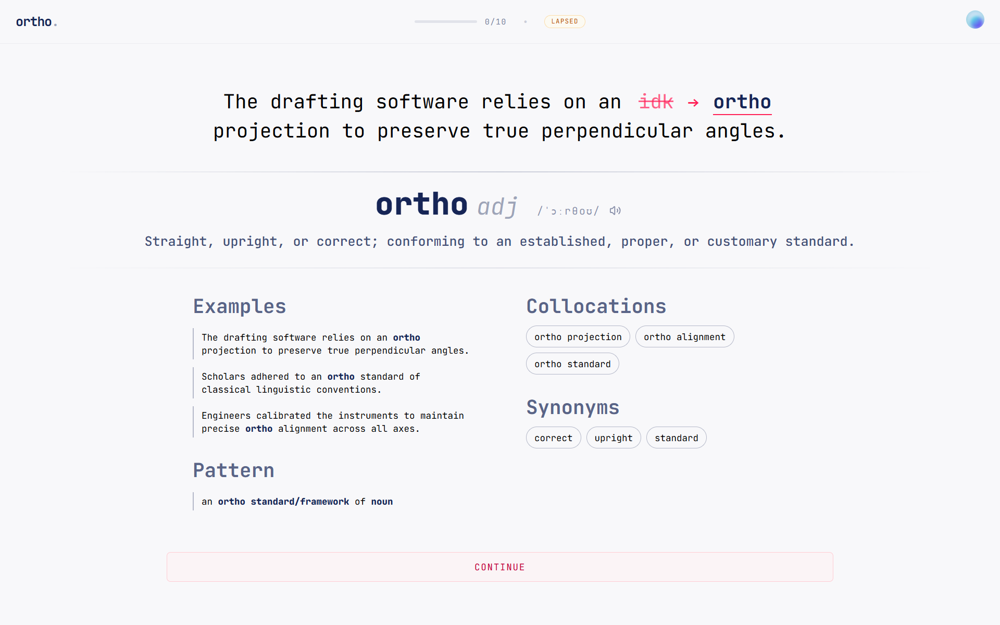

# ortho.

> A minimalist, dictionary-grade vocabulary trainer powered by Spaced Repetition (SM-2).

[](https://lehoangtrieu-dev.github.io/ortho/)
[](https://react.dev/)
[](https://www.typescriptlang.org/)
[](https://tailwindcss.com/)

<p align="center">
  
</p>

---

## ✨ Features

- **📖 Authentic Dictionary Depth**: Curated Oxford Learner's Dictionary dataset across CEFR levels (A1–C1). Each word includes definitions, IPA phonetics, native audio pronunciations, collocations, synonyms, and grammatical usage patterns.
- **📐 IELTS Grammar Patterns & Collocations**: Displays natural prepositional and structural patterns (e.g. `a student at [school/university]`, `attend [school]`) to directly target IELTS Lexical Resource & Grammatical Range scoring.
- **🧠 Spaced Repetition (SuperMemo SM-2)**: Features a mathematically sound SM-2 engine that calculates optimal review intervals, adjusts per-card ease factors, and manages lapse recovery loops for long-term retention.
- **🗓️ Thematic Weekly Intake**: Automatically rotates through 10 curated IELTS topic domains (Environment, Education, Technology, Health, etc.) every calendar week while reinforcing all previously learned words via SM-2.
- **✍️ Active Recall in Context**: Tests words inside real-world example sentences with a responsive, auto-resizing fill-in-the-blank input and custom animated caret.
- **🎙️ Zero-Latency Pronunciation**: Integrated browser SpeechSynthesis with native accent selection, operating completely offline without external API rate limits.
- **☁️ Cloud Sync & Offline Resilience**: Seamless cross-device synchronization with Google Authentication and Cloud Firestore, backed by immediate local caching.
- **🎨 Editorial Aesthetic**: Minimalist, distraction-free typographic layout inspired by classical paper dictionaries, enriched with smooth Framer Motion card transitions and an animated session bumper.

---

## 🛠️ Tech Stack

- **Framework**: [React 19](https://react.dev/) with [Vite](https://vite.dev/)
- **Language**: [TypeScript](https://www.typescriptlang.org/)
- **Styling**: [Tailwind CSS v4](https://tailwindcss.com/)
- **Animation**: [Framer Motion](https://www.framer.com/motion/)
- **Data Fetching & Cache**: [TanStack Query v5](https://tanstack.com/query/latest)
- **Backend & Auth**: [Firebase](https://firebase.google.com/) (Authentication & Firestore)
- **Deployment**: [GitHub Actions](https://github.com/features/actions) & [GitHub Pages](https://pages.github.com/)

---

## 🧮 The SM-2 Algorithm

Ortho schedules cards using the SuperMemo SM-2 algorithm:

### 1. Interval Progression ($I$)
* **First review ($n = 1$)**: $I_1 = 1\text{ day}$
* **Second review ($n = 2$)**: $I_2 = 6\text{ days}$
* **Subsequent reviews ($n > 2$)**: $I_n = I_{n-1} \times \text{EF}$

### 2. Ease Factor ($\text{EF}$)

$$
\text{EF}' = \max\left(1.3, \text{EF} + (0.1 - (5 - q) \times (0.08 + (5 - q) \times 0.02))\right)
$$

* **Recall Quality ($q$)**: Ortho assigns $q = 5$ for correct answers and $q = 0$ for lapses.
* **Ease Factor Floor**: $\text{EF}$ starts at $2.5$ and is capped at a minimum of $1.3$.

### 3. Lapse Recovery
If an answer is incorrect ($q = 0$):
* Consecutive repetitions reset to $0$.
* Review interval resets to $1$ day.
* The card is automatically appended to the end of today's queue for immediate re-testing.

---

## 🚀 Getting Started

### Prerequisites

- [Node.js](https://nodejs.org/) (version 20 or higher recommended)
- `npm`

### Installation

```bash
# 1. Clone the repository
git clone https://github.com/lehoangtrieu-dev/ortho.git

# 2. Navigate to project folder
cd ortho

# 3. Install dependencies
npm install

# 4. Start development server
npm run dev
```

> [!NOTE]
> **Firebase Setup**: Ortho comes pre-configured with a live demo Firebase instance in `src/lib/firebase.ts`. To connect your own Firebase project, create a project at [Firebase Console](https://console.firebase.google.com/) and update the credentials in `src/lib/firebase.ts`.

### Build & Preview

```bash
# Compile and build for production
npm run build

# Preview production build locally
npm run preview
```

---

## 📄 License

This project is licensed under the [MIT License](LICENSE.md).
